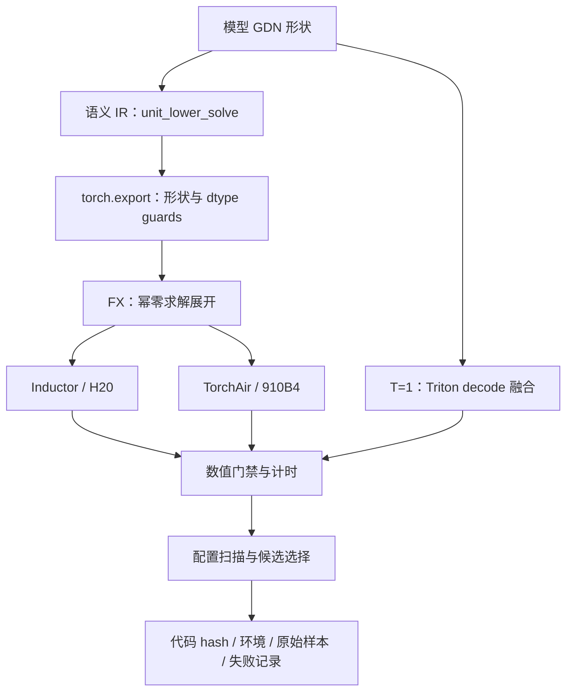

# DeltaForge 项目设计与技术手稿

本文保留公式、张量契约和实现决策。第一次阅读可先看 [原理阅读版](DESIGN-friendly.md)。当前训练结果见 [TRAINING_RESULTS.md](TRAINING_RESULTS.md)，早期双硬件算子结果见 [RESULTS.md](RESULTS.md)，选题来源见 [RESEARCH.md](RESEARCH.md)。

## 项目问题与边界

面向部署 Qwen 混合注意力模型的框架开发者，解决 GDN 递推依赖、三角求解的后端适配和形状特化问题。第一阶段优化变量是通过数值验收的稳定算子执行时间；最终变量是模型 TTFT / TPOT、吞吐和显存，须另做端到端实验。

当前实现包含逐 token recurrence、chunk prefill、可微分块求解、可恢复 Qwen3.5 adapter 和直接 compiled 训练路径。固定 H20 LoRA 已完成数值与完整步验证。早期领域 `unit_lower_solve`、FakeTensor、FX doubling、Inductor／TorchAir 与 Triton decode 保留为独立实验路径。

NPU 历史验证使用 PyTorch 原语和 TorchAir，没有手写 AscendC kernel。新 block 的 NPU 训练、融合 backward、在线 bucket／cache 策略、packed serving 和完整模型推理仍待验证。

代码位于独立 deltaforge/，不属于 vLLM-Omni 上游贡献；未来提出上游 PR 时，另行满足其 contributor intent 与验证要求。

## 张量与状态契约

| 张量 | 布局 | 语义 |
|---|---|---|
| Q / K | [B,T,Hk,K] | core 输入已 L2 归一化；查询缩放只施加一次 |
| V | [B,T,Hv,V] | Hv 必须是 Hk 的整数倍；K 与 V 可不同 |
| g / β | [B,T,Hv] | g 是非正 log decay；β∈[0,1] |
| S₀ | [B,Hv,K,V] | FP32；函数不原地修改调用方 state |
| lengths | [B]，可选 | 有效长度；padding 是恒等状态转移 |

以下单 token 的 q、k、v 均为列向量，维度分别为 dₖ、dₖ、dᵥ；S 为 dₖ×dᵥ 矩阵。q 在递推公式中尚未缩放。令 αₜ=exp(gₜ)：

\[
\bar S_t=\alpha_t S_{t-1},\quad
r_t=\beta_t(v_t-\bar S_t^\top k_t),\quad
S_t=\bar S_t+k_t r_t^\top,\quad
o_t=S_t^\top q_t/\sqrt{d_k}.
\]

等价为 \(S_t=\alpha_t(I-\beta_t k_tk_t^\top)S_{t-1}+\beta_t k_tv_t^\top\)。不能混用其他库的 V×K 转置布局。外部调用方负责 gate 构造、Q/K normalization 和 Request ID 到 state slot 的映射。

chunk 公式中 Q／K／V 按 token 为行堆叠，分别为 C×dₖ、C×dₖ、C×dᵥ，Q 已除以 √dₖ。这里的 K 是 key 矩阵；张量布局中的 K 维度对应 dₖ。定义 \(G_i=\sum_{t=0}^i g_t\)，\(D_{ij}=\exp(G_i-G_j)\)（i≥j，其余为零）：

\[
L=\operatorname{StrictLower}[\operatorname{diag}(\beta)(KK^\top\odot D)],\quad A=(I+L)^{-1},
\]
\[
U=A\operatorname{diag}(\beta)V,\quad
W=A\operatorname{diag}(\beta\exp G)K,\quad R=U-WS_0,
\]
\[
O=\operatorname{diag}(\exp G)QS_0+(QK^\top\odot D)R,
\]
\[
S_1=\exp(G_{C-1})S_0+K^\top\operatorname{diag}[\exp(G_{C-1}-G)]R.
\]

此处 Q 已包含 scale。U/W 拼接 RHS 后共同求解，避免重复求解。公式基于既有 GDN chunk 化原理，不宣称原创。

避免直接计算 exp(G_tail)/exp(G_i)，长序列时分母会 underflow。实现用 prefix 差后取 exp；上三角先限制指数再 mask，避免无效正指数 overflow。padding 令 Q/K/V/β/g 为零，保留 state，输出为零。

## 求解算法：合法性与浮点稳定性

令 M=I+L。当前训练默认用分块三角逆：

\[
M=\begin{bmatrix}A&0\\B&D\end{bmatrix},\qquad
M^{-1}=\begin{bmatrix}A^{-1}&0\\-D^{-1}BA^{-1}&D^{-1}\end{bmatrix}.
\]

递归求解对角块，再组合 cross block，避免显式形成大矩阵幂。可微 PyTorch 原语保留 autograd，训练设置 `semantic_solve=False`。直接 `solve_triangular` 与独立 recurrence 用于交叉核验。

旧 doubling 在真实模型出现浮点抵消：同输入第 22 层输出 relative L2 为 16.5455，新 block 为 3.34325e-5。对于 `L=0.999×tril(ones,-1)`、C=64，旧方法 inverse max abs 为 2.57698e10，新 block 为 5.9605e-8。[反例记录](training-results/cancellation-counterexample.json) 支持本次替换，但没有证明 block 对所有合法输入的误差上界。

下面保留旧展开的推导，以说明它为什么数学成立、却不足以保证浮点结果。

严格下三角 C×C 的 L 满足 L 的 C 次方为零。令 X=−L：

\[
(I+L)^{-1}=I+X+\cdots+X^{C-1}.
\]

使用 finite doubling：

1. power=−L，inverse=I+power。
2. 每级 power=power@power。
3. inverse=inverse+power@inverse，直到覆盖 C−1 次幂。

C=64 时初始一次幂后执行 5 级 doubling，新增 10 次小矩阵乘。非 2 的幂 C 也成立，多余的幂在实数域为零。该恒等式既不保证浮点 bitwise 相同，也不保证中间量不会放大误差。

FX 只展开领域 unit_lower_solve，不能把任意 linalg_solve_triangular 改成有限多项式。一般三角矩阵不满足幂零性。torch.export 捕获固定 shape；torch.compile 按 dtype / device 特化。调用方使用 validate_inputs 核验 g、β、有限性和布局契约；这些值域检查未嵌入编译热路径。

改写首先提供可编译的后端形式，性能收益必须实测。通用三角求解可能已高度优化，新增小 GEMM 也可能变慢；不先承诺超越 FLA / FlashQLA。

## 编译与执行结构

当前真实训练直接 compile block GDN，并验证 forward／backward／非重入 checkpoint。以下图描述的是早期 `compiler.py` 语义 lowering，仍使用 doubling，未纳入新训练支持：

当前按 shape 导出完整静态图，chunk 递推在 export 时展开。decode 另走 fused kernel。已处理 PyTorch 2.7 generated Python 中的 NPU torch.device 构造问题；把固定 eye / ones 提升为图外 device buffer，绕开 TorchAir 缺失的 aten.eye converter。每项修复都保留旧源码与失败事件，并以实机 fullgraph 数值通过作为编译验收。

## CUDA decode 的优化对象

一个 Triton program 处理一个 batch/head 与一个 value tile，将衰减、KᵀS、误差、rank-1 更新和 QᵀS 融合；FP32 state 只读一次、写一次。value tile 可提高并行度，但会重复 Q/K 读取。扫描 tile=8/16/32/64、warps=4/8，B=1/4/16，并验证 GQA 和非 2 的幂 K/V。

这是 memory / launch 优化路径，不能据总延迟自动判断 HBM 带宽已满或 SM occupancy。需要 profiler 才能作硬件归因。

## 双硬件资源与实验协议

2026-10-25 02:58:58 +08:00，CN Resource 查询 group_name_contains=search_douyin_life_nlp、cluster_name_contains=cloudnative-hl；group 2079、cluster 20。request_id：20261025025858DE6F292FE75AA2C126FF。

| 队列 | 剩余卡 | 剩余 CPU | 剩余内存 MB | 首轮请求 |
|---|---:|---:|---:|---|
| ai / NVIDIA-H20 | 22 | 446 | 5,949,440 | 1 卡、20 CPU、230,400 MB |
| ascend / Ascend910b4-64G | 1 | 22 | 223,232 | 1 卡、15 CPU、128,000 MB |

余量是时点聚合值，不提供占用归因或 ETA。两个后端独立运行，不做跨厂商 all-reduce。每任务限制 3600 秒且不自动重启。worker 使用自包含源码，不依赖开发机用户路径。

探针确认 H20 SM90 / PyTorch 2.9.1 / Triton 3.5.1；910B4 PyTorch 2.7.1+cpu / torch-npu 2.7.1 / TorchAir 可导入。NPU 镜像有名为 Triton 的包不证明 Triton-Ascend 可用。

每格先数值后计时，4 次预热、7 组重复、每组 5 次调用；记录 wall 和 device event 原始样本。event 时间可能含 CPU 提交空洞，不是纯 kernel compute time。编译与首次执行单独记录；扫描最优值仅称候选。随机输入仅用于算子夹具，不能作为任务准确率或业务性能证据。

| 验证层 | 对照 | 当前可声称的边界 |
|---|---|---|
| 数学 | token recurrence ↔ chunk | GQA、K≠V、padding、g=0、强负 gate、非零初始 state |
| 梯度 | 两路径 autograd；inverse gradcheck | 纯 PyTorch backward，非 fused backward |
| 编译 | semantic solve ↔ FX lowering | domain op 消失，fullgraph 编译后数值通过才算成功 |
| decode | PyTorch recurrence ↔ Triton | 算子参考基线；不是 FLA / FlashInfer |
| prefill | 同 chunk eager ↔ compiled | 相同 dtype / shape；不能合并不同 chunk 与精度收益 |
| 模型训练 | 真实单层、整模型、完整 LoRA 步 | 固定 H20、torch 参照通过；原生默认／FLA 梯度未闭合 |
| 模型推理 | 完整服务负载 | 未验证，不填写端到端 TTFT／TPOT 收益 |

不同设备的软件栈和 CPU 配额不同，不能用两端 wall 比值单独归因芯片。失败编译保留原始错误，eager fallback 不能记作 compiled。

## 后续深化与完成标准

| 阶段 | 具体工作 | 完成标准 |
|---|---|---|
| 原生 prefill | H20 TileLang；910B4 AscendC；Cube / Vector 分工、double buffer、融合边界 | 与 FLA / FlashQLA / NPU native 同形状对照，三次独立确认 |
| 动态运行 | shape buckets、编译 cache、packed layout、state slot ownership、admission | 重编译次数、cache hit、padding waste、TTFT 分布 |
| 融合 backward | 推导梯度、重算与片上资源取舍 | gradcheck、long-context 数值和显存 / 时间对照 |
| 模型闭环 | 在已通过固定 LoRA 的基础上闭合原生梯度比较，延长训练预算，再验证推理接入 | 逐层误差、参数梯度、任务质量、完整步与推理时间／显存 |

建议 T 按 128/256/512/1024/2048/4096 分桶并保留 lengths。cache key 包含代码 hash、backend、硬件、驱动/CANN、框架版本、shape、dtype 和 chunk。padding waste 超过 20% 时考虑细桶 / eager，此阈值是设计起点，尚未证明最优。

编译成本 C、每调用节省 Δ，盈亏平衡调用数为 ceil(C/Δ)。Δ≤0 不发布。过度融合可能挤压寄存器/UB 和 occupancy，必须保留两 kernel 方案。上下文 affine scan 增加 K³ 运算；弱衰减 head 不能直接丢弃历史。gate truncation 是近似算法，需额外误差与任务质量门禁。

## 学习与复核

独立推导幂零展开与 padding 恒等状态；说明为什么仅匹配领域 op；比较 FP32 state 与 BF16 activation；解释 value tile 并行度与 Q/K 冗余；区分 TorchAir 编译和 AscendC kernel；用 Amdahl 定律解释 operator speedup 的端到端上限；计算编译回本次数；指出 state slot 与 Request ID 的一致性边界。完成独立复跑与修改一项 kernel schedule 后，再将“AI 辅助实践”更新为个人独立完成的贡献。

本轮离线配置建议见 artifacts/dispatch-plan.json：910B4 T=512 不选 compiled；T=128 仅约 5% 的节省，预计需要约 88 万次调用摊销本轮编译成本，须先独立确认。当前没有在线 dispatcher / cache。
