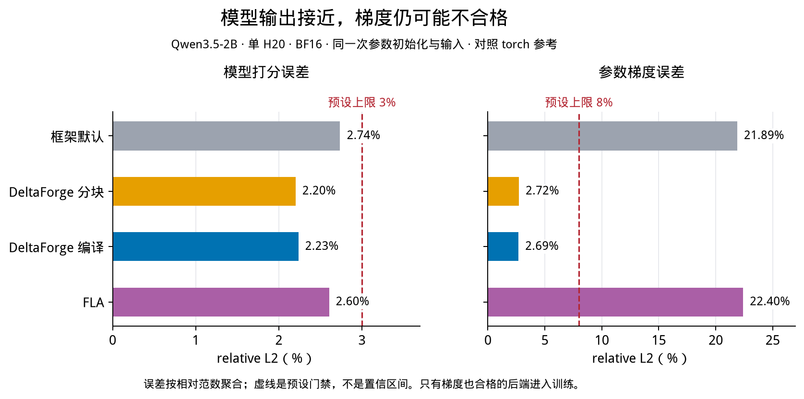
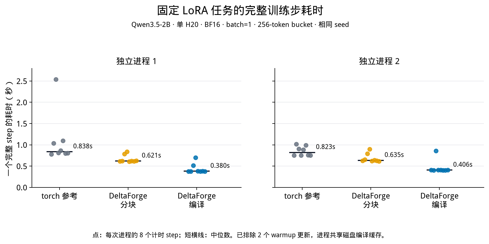
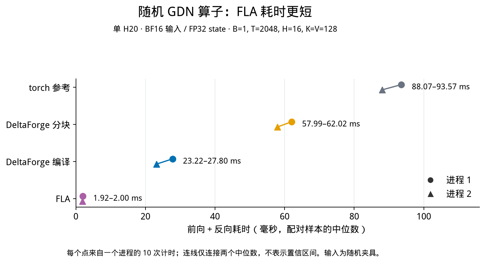

# 一步步认识 DeltaForge 项目

这不是 GDN 论文精读，也不是命令手册。

它只做一件事：让已经具备大模型基础知识的读者，按顺序建立理解 DeltaForge 所需的认知。

本文默认你已经知道：

- token、embedding、线性层、Q/K/V 和 attention 的基本概念；
- PyTorch、GPU、前向传播、反向传播和梯度；
- 训练与推理的区别。

这些基础知识不再重复。LoRA、GDN state、chunk、数值门禁等与本项目直接相关的概念，会在需要时解释。

请按顺序阅读。每一步只增加一个新概念。读完一步后，先回答该步末尾的问题；答不出来就停在这里，不要继续查后面的术语。

全文分为 10 个阶段。本文中的数字来自 2026-10-25 已完成的历史实验，不是你刚刚运行得到的结果。

---

## 第一阶段：先看懂项目到底改了什么

### 第 1 步：Qwen3.5 不只有普通 attention

Qwen3.5-2B 的部分层使用 Gated DeltaNet，简称 GDN。

先不研究 GDN 的公式。只把它理解成模型内部一种“读取历史并更新历史”的计算部件。

模型的其他部分仍然包括投影、卷积、普通 attention、MLP 和输出层。

只记住：**GDN 是 Qwen3.5 内部的一类计算部件，不是整个模型。**

停下来回答：DeltaForge 研究的是整个 Qwen，还是其中的 GDN 计算？

---

### 第 2 步：项目不修改模型任务

DeltaForge 不改变 tokenizer，不改变预训练权重代表的语言能力，也不把 Qwen 换成另一个模型。

它只尝试替换 GDN 的计算实现：

```text
同一个 Qwen3.5
    ↓
只替换 GDN callable
    ↓
检查模型是否仍能正确训练
```

callable 可以先理解成“模型执行 GDN 时实际调用的函数”。本文把完成同一 GDN 计算的不同实现称为**后端**。

只记住：**项目改变 GDN 的执行方法，不改变模型任务。**

停下来回答：DeltaForge 会不会把 Qwen3.5 训练成另一种任务模型？

---

### 第 3 步：原模型的其他路径保持不变

替换 GDN 时，模型的参数、卷积、投影、norm、普通 attention 和优化器继续由 Transformers 与 PyTorch 管理。

这样做是为了缩小变量范围。观察到差异时，才能优先检查 GDN 后端，而不是同时怀疑整个模型结构。

只记住：**实验只替换 GDN，尽量固定其他计算。**

停下来回答：为什么不能同时修改 GDN、MLP 和优化器，再把结果全部归因于 GDN？

---

### 第 4 步：项目同时关心正确性和速度

新后端更快，但输出或梯度错误，不能使用。

新后端正确，但比原路径更慢，也不能称为性能优化。

因此项目要依次回答：

1. GDN 单层计算是否接近参照？
2. 整个模型的输出和参数梯度是否接近参照？
3. 是否真的完成参数更新？
4. 完整训练步是否更快？

只记住：**“能运行”“算得对”“能训练”“更快”是四项不同验收。**

停下来回答：程序 exit 0，是否已经证明新后端可以用于训练？

---

### 第一阶段检查

你现在应该能说出这条主线：

```text
同一个 Qwen3.5
→ 只替换 GDN 计算
→ 先检查数值
→ 合格后训练
→ 最后比较完整 step
```

如果仍把 DeltaForge 理解成“训练一个新模型”，请不要继续。

---

## 第二阶段：理解 GDN 保存了什么

### 第 5 步：GDN 有一份持续更新的 state

普通 attention 会直接使用一段序列中的 K/V。

GDN 还维护一个状态矩阵 `S`。它把前面 token 留下的信息压进固定大小的 state，并把更新后的 state 交给后面的 token。

```text
旧 state + 当前 token 信息
          ↓
      新 state
```

只记住：**state 是 GDN 在 token 之间传递的历史。**

停下来回答：第 10 个 token 的 GDN 计算是否与前 9 个 token 完全无关？

---

### 第 6 步：K 决定从 state 的哪个方向读取

当前 token 的 key 记作 `k`。

GDN 用 `k` 从旧 state 中读出“这个方向已经记住了什么”：

```text
predicted = Sᵀk
```

这里不需要展开矩阵乘法。只看语义：`predicted` 是 state 对当前 key 的已有预测。

只记住：**k 用来查询 state 已经保存的内容。**

停下来回答：`predicted` 来自新 value，还是来自旧 state？

---

### 第 7 步：V 表示当前希望写入的内容

当前 token 的 value 记作 `v`。

如果 `v` 与 state 已经读出的 `predicted` 一样，就没有必要重复写入。

项目计算：

```text
residual = v - predicted
```

residual 表示“当前想写入的内容”与“state 已经知道的内容”之间的差。

只记住：**GDN 写入的是修正量，不是无条件覆盖旧 state。**

停下来回答：当 `v == predicted` 时，residual 是多少？

---

### 第 8 步：beta 控制本次修正力度

`beta` 的范围是 0 到 1。

```text
r = beta × (v - predicted)
```

- `beta=0`：这次不写修正。
- `beta=1`：完整写入修正。
- 中间值：只写入一部分。

只记住：**beta 决定当前 token 对 state 的更新强度。**

停下来回答：`beta=0` 时，当前 value 的修正会不会写入 state？

---

### 第 9 步：g 控制旧 state 保留多少

项目中的 `g` 是非正的 log decay。

先计算：

```text
alpha = exp(g)
```

因为 `g≤0`，所以 `alpha` 在 0 到 1 之间。旧 state 先乘 `alpha`：

```text
S_bar = alpha × S_old
```

`g` 越负，旧信息衰减越强；`g` 接近 0，旧信息保留越多。

只记住：**g 决定旧 state 的保留程度。**

停下来回答：`g` 接近 0 时，旧 state 保留得更多还是更少？

---

### 第 10 步：一次完整更新由“衰减、读差、写回”组成

把前面三步合起来：

```text
S_bar = exp(g) × S_old
predicted = S_barᵀk
r = beta × (v - predicted)
S_new = S_bar + k rᵀ
```

最后，query `q` 从新 state 中读出当前输出：

```text
output = S_newᵀq / sqrt(dk)
```

只记住：**GDN 先更新 state，再用 q 读取输出。**

停下来回答：当前 token 的输出读取的是更新前 state，还是更新后 state？

---

### 第 11 步：用一个标量例子检查直觉

暂时把矩阵都缩成一个数：

```text
旧 state = 2
alpha = 0.9
k = 1
v = 3
beta = 0.5
```

计算过程：

```text
衰减后 state = 2 × 0.9 = 1.8
已有预测       = 1.8 × 1 = 1.8
差值           = 3 - 1.8 = 1.2
实际修正       = 1.2 × 0.5 = 0.6
新 state       = 1.8 + 1 × 0.6 = 2.4
```

真实模型使用矩阵和多个 head，但更新逻辑相同。

只记住：**GDN 的核心是“比较已有记忆与当前 value，再写入差值”。**

停下来回答：这个例子中，如果 beta 改成 1，新 state 是多少？

---

### 第 12 步：state 必须正确交给下一段

长序列可能分段处理。第一段结束后得到的 final state，要作为第二段的 initial state。

```text
第 1 段 → final state
              ↓
第 2 段 ← initial state
```

训练时，跨段的梯度关系也不能被无意切断。

只记住：**state handoff 是 GDN 跨 segment 保持连续历史的边界。**

停下来回答：第二段使用全零 state，能否等价于连续处理完整序列？

---

### 第二阶段检查

你现在应该能解释五个对象：

| 对象 | 在 GDN 中的作用 |
|---|---|
| state `S` | 保存前面 token 压缩后的历史 |
| `k` | 从 state 查询已有内容，并决定写入方向 |
| `v` | 当前希望写入的内容 |
| `beta` | 控制当前修正力度 |
| `g` | 控制旧 state 的衰减 |

如果还不能说出“衰减、读差、写回”，请回看第 5 到 11 步。

---

## 第三阶段：为什么要把递推改成 chunk

### 第 13 步：最直接的实现是逐 token recurrence

第 2 个 token 依赖第 1 个 token 的新 state，第 3 个依赖第 2 个。

按照顺序逐个执行，叫作 recurrence：

```text
token 1 → S1
token 2 + S1 → S2
token 3 + S2 → S3
...
```

这条路径与公式最接近，适合当独立正确性参照。

只记住：**recurrent 路径按 token 顺序更新 state。**

停下来回答：为什么 token 3 不能直接绕过 token 2 的 state 更新？

---

### 第 14 步：逐 token 执行不利于长序列计算

如果一段有 2048 个 token，逐个执行会产生很长的依赖链。

GPU 擅长较大的规则矩阵计算。大量小步骤还可能增加框架调度和 kernel 发射。

这不表示 recurrence 数学错误，只表示它未必是高效执行形式。

只记住：**正确性参照不一定是最快实现。**

停下来回答：recurrent 路径慢，是否说明它不适合作为数值参照？

---

### 第 15 步：chunk 把一段 token 放进一个块

项目把序列按固定长度切块，例如 `chunk_size=32`：

```text
token 0..31   → chunk 0
token 32..63  → chunk 1
...
```

每个 chunk 接收一份 initial state，计算块内所有输出，并产生 final state。

只记住：**chunk 改变计算组织方式，不改变 state 的连续性。**

停下来回答：chunk 0 的 final state 会不会交给 chunk 1？

---

### 第 16 步：chunk 没有删除 token 依赖

块内第 20 个 token 仍然依赖块内前 19 个 token。

chunk 做的事情，是把这组依赖写成一个下三角关系。下三角的含义是：

```text
第 i 行只依赖第 0..i 行
```

未来 token 不会影响过去 token。

只记住：**chunk 用下三角矩阵表示因果依赖。**

停下来回答：chunk 是否把 32 个 token 变成完全互不依赖？

---

### 第 17 步：块内核心问题变成一个三角方程

项目构造严格下三角矩阵 `L`，再求：

```text
(I + L)Y = RHS
```

也可以写成：

```text
Y = (I + L)^(-1) RHS
```

`RHS` 合并了块内 value 和 key 相关项。此时先不用展开 `U/W/R` 的完整推导。

只记住：**chunk 计算的核心变成求解单位下三角方程。**

停下来回答：chunk 路径最关键的线性代数操作是什么？

---

### 第 18 步：同一个 solve 同时服务两组右端

实现把两组右端拼在一起：

```python
rhs = torch.cat((beta * v, beta * exp(prefix) * k), dim=-1)
```

求解一次后再拆成 `U` 和 `W`。

这样避免对同一个 `(I+L)` 重复求解。

只记住：**U/W 共用同一个三角系统，只是右端不同。**

停下来回答：为什么实现要先拼接 RHS，再统一求解？

---

### 第 19 步：块内结果还要与初始 state 合并

求出 `U` 和 `W` 后，项目计算：

```text
R = U - W × initial_state
```

`R` 同时包含块内 token 关系与进入该块之前的历史。

随后用 `R` 计算：

1. 块内所有输出；
2. 传给下一个 chunk 的 final state。

只记住：**chunk 计算没有忽略进入块之前的 state。**

停下来回答：如果去掉 `initial_state`，分段处理还能否保持完整历史？

---

### 第 20 步：recurrence 与 chunk 必须回答同一个问题

对相同输入和 initial state，两条路径应得到接近的：

```text
所有 token 输出
final state
输入梯度
```

只比较输出、不比较 final state，会漏掉后续 segment 的潜在错误。

只记住：**GDN 验收必须同时检查 output、state 和 gradient。**

停下来回答：为什么当前 chunk 输出正确，还不能证明下一段也正确？

---

### 第三阶段检查

你现在应该能画出：

```text
逐 token recurrence
        ↕ 数值对照
chunk → 构造 L → 求解 (I+L)Y=RHS → output + final state
```

如果还不理解 `L` 为什么是下三角，只回看第 16 和 17 步。

---

## 第四阶段：旧算法为什么数学正确却实际失败

### 第 21 步：严格下三角矩阵具有幂零性

对于大小为 `C×C` 的严格下三角矩阵 `L`：

```text
L^C = 0
```

这叫作幂零性。

直观上，每乘一次 `L`，有效信息会继续向下移动；移动 `C` 次后超出矩阵范围。

只记住：**严格下三角矩阵的足够高次幂必定为零。**

停下来回答：一般的非下三角矩阵是否也自动满足 `L^C=0`？

---

### 第 22 步：幂零性给出有限逆展开

因为 `L^C=0`：

```text
(I+L)^(-1) = I - L + L² - ... + (-L)^(C-1)
```

展开会在有限项结束，不是无限级数近似。

在精确实数运算中，这个等式成立。

只记住：**旧算法来自一个有明确条件的精确恒等式。**

停下来回答：这个展开为什么不需要一直加到无穷？

---

### 第 23 步：doubling 减少逐次计算幂的层数

旧实现没有顺序计算所有 `L²、L³、L⁴...`。

它反复平方矩阵幂，并更新 inverse：

```text
power = -L
inverse = I + power
power = power @ power
inverse = inverse + power @ inverse
...
```

这种组织叫 finite doubling。

只记住：**doubling 是计算有限逆展开的一种执行方法。**

停下来回答：doubling 的合法性依赖一般三角矩阵，还是严格下三角的幂零性？

---

### 第 24 步：实数恒等式不等于浮点稳定

计算机使用有限位数表示浮点数。

某些输入会让中间矩阵幂变得很大，最终答案却依赖大数之间的抵消。

教学示例：

```text
(100000000 + 1) - 100000000
```

如果中间精度不足，`+1` 可能先丢失，最后得到 0。

只记住：**公式精确，只能证明目标值；不能保证浮点中间过程稳定。**

停下来回答：一个数学上精确的改写，是否自动保证 FP32 结果可靠？

---

### 第 25 步：随机输入没有覆盖危险区域

早期测试使用固定 seed 随机 Q/K/V。

随机测试能发现许多普通错误，但没有自动覆盖：

- 多个 key 近似共线；
- `g` 接近 0，历史衰减很弱；
- `beta` 接近 1，更新强；
- 长 chunk 中中间矩阵幂放大。

真实模型恰好可能产生这些结构。

只记住：**随机测试通过不代表真实输入分布已经覆盖。**

停下来回答：为什么一个随机单测通过，仍可能在预训练模型中失败？

---

### 第 26 步：项目构造了一个可重复反例

反例使用：

```text
L = 0.999 × tril(ones, -1)
```

当 `C=64` 时：

| 方法 | inverse 最大绝对误差 |
|---|---:|
| 旧 doubling | `2.57698e10` |
| 新 block | `5.9605e-8` |

这个反例把“可能不稳定”变成了可复现故障。

只记住：**旧算法的浮点问题有明确反例，不只是猜测。**

停下来回答：`2.57698e10` 描述的是模型质量，还是这个矩阵求逆反例的数值误差？

---

### 第 27 步：真实模型也出现了对应故障

第二轮实验中，旧 DeltaForge／compiled 路径的整模型 logits 误差约为 32%，未进入训练。

固定真实模型层输入后，层索引 22 的输出 relative L2：

```text
旧 doubling：16.5455
新 block：   3.34325e-5
```

这说明反例对应的问题也出现在实际模型路径中。

只记住：**故障既有人工反例，也有真实层证据。**

停下来回答：第二轮为什么没有直接忽略 32% 误差继续训练？

---

### 第 28 步：编译器不能修复错误的数值表达

旧表达式传给 `torch.compile` 后，编译器可以改变执行计划。

它不会自动知道“这个有限展开在当前输入上发生了大数抵消”，也不会主动替换成更稳定的算法。

因此第二轮中，DeltaForge eager 与 compiled 都失败。

只记住：**compile 优化执行，不替你选择数值稳定算法。**

停下来回答：旧 eager 结果错误时，直接加 `torch.compile` 是否足以解决问题？

---

### 第四阶段检查

你现在应该能区分：

```text
数学合法：严格下三角 → 有限逆展开成立
浮点稳定：中间量是否会放大并发生抵消
```

这两件事不能互相替代。

---

## 第五阶段：新 block 方法解决了什么

### 第 29 步：block 方法先把矩阵分成四块

单位下三角矩阵可以写成：

```text
M = [ A  0 ]
    [ B  D ]
```

它的逆为：

```text
M⁻¹ = [ A⁻¹          0 ]
      [ -D⁻¹BA⁻¹   D⁻¹ ]
```

右上角为 0，是因为原矩阵是下三角。

只记住：**大矩阵的逆可以由两个较小对角块的逆组合。**

停下来回答：block 方法是否还需要求解 `A` 和 `D` 两个子问题？

---

### 第 30 步：block 方法避免显式形成大矩阵幂

实现递归组合小块 inverse 和 cross block：

```text
先得到 A⁻¹ 和 D⁻¹
再计算 -D⁻¹BA⁻¹
最后拼成更大的 inverse
```

它仍然使用矩阵乘，但不再显式构造 `L²、L⁴、L⁸...` 的大中间幂。

只记住：**block 的主要改变是计算路径，不是改变目标方程。**

停下来回答：block 和 doubling 最终想求的是不是同一个 `(I+L)^(-1)`？

---

### 第 31 步：block 继续使用 PyTorch autograd

block 实现由 `matmul`、`cat`、`pad` 等 PyTorch 操作组成。

因此反向传播可由 autograd 追踪，不需要先手写一个新的 backward kernel。

这降低了首轮接入训练的复杂度。

只记住：**block 是可微的 PyTorch 组合路径。**

停下来回答：本轮 block 训练是否依赖自研 fused backward？

---

### 第 32 步：项目保留两个独立参照

为了避免“新方法和旧方法一起错”，项目还保留：

1. `recurrent`：逐 token 独立递推；
2. `triangular`：直接调用 `torch.linalg.solve_triangular`。

三条不同计算路径接近时，证据比只比较 block 与 doubling 更强。

只记住：**不同实现之间的交叉核验用于降低共同错误风险。**

停下来回答：为什么不能只看 block 比 doubling 误差小，就认定 block 一定正确？

---

### 第 33 步：block 的实测改进不是普遍稳定性定理

block 在人工反例和固定真实层输入上误差更小。

这支持“本次故障由旧计算路径触发，新路径修复了已测范围”。

它没有证明：

```text
任意长度、任意合法输入、任意精度下都稳定
```

只记住：**实测修复有适用范围，不是全输入误差上界证明。**

停下来回答：能否根据一个 `C=64` 反例，就声称 block 对所有长度永远稳定？

---

### 第 34 步：代码入口是 `ops.py`

第一次打开 [ops.py](https://github.com/CheongRoach/deltaforge/blob/main/deltaforge/ops.py)，只找四个对象：

```text
recurrent
inverse_unit_lower
block_inverse_unit_lower
GDN.forward
```

先沿这条顺序看：

```text
递推参照
→ 旧 doubling inverse
→ 新 block inverse
→ chunk GDN 怎样选择求解方法
```

本步不要研究所有 shape 检查。

只记住：**`ops.py` 包含数学执行路径。**

停下来回答：旧 doubling 与新 block 在哪个文件中可以直接对照？

---

### 第五阶段检查

你现在应该能解释：

```text
旧 doubling：利用幂零有限展开，但存在浮点抵消反例
新 block：递归组合子块，避免显式大矩阵幂
triangular/recurrent：独立正确性参照
```

如果这三类路径仍混在一起，请不要进入后端接入。

---

## 第六阶段：理解五种后端与 adapter

### 第 35 步：后端表示“同一 GDN 契约的不同实现”

项目定义了五个可选择后端：

| 名称 | 实际计算 |
|---|---|
| `torch` | Transformers 5.2 的显式 torch chunk 参考 |
| `deltaforge` | 新 block GDN |
| `compiled` | `torch.compile` 新 block GDN |
| `fla` | fla-core 0.4.1 的 GDN kernel |
| `recurrent` | 本项目逐 token 参照 |

训练 probe 还保留 `default`，表示完全不替换模型原生 callable。

只记住：**后端名称对应不同实现，不对应不同模型权重。**

停下来回答：`default` 与显式 `torch` adapter 是否必然是同一个调用路径？

---

### 第 36 步：所有后端必须遵守共同输入契约

共同接口接收：

```text
Q/K: [B,T,Hk,K]
V:   [B,T,Hv,V]
g、beta
initial_state
scale
```

它还统一处理：

- Q/K normalization；
- query scale 只施加一次；
- GQA head repeat；
- FP32 functional state；
- final state 布局。

只记住：**公平比较前，先把输入语义与 state 契约对齐。**

停下来回答：如果一个后端多做一次 normalization，性能和数值差异还能否只归因于 kernel？

---

### 第 37 步：functional state 表示不原地改调用方状态

后端接收 `initial_state`，返回新的 `final_state`。

```text
output, final_state = backend(..., initial_state)
```

调用方决定怎样保存和交接它。

这种接口适合训练 autograd，也避免调用方难以追踪的隐式状态修改。

只记住：**state 的所有权和生命周期由接口明确表达。**

停下来回答：后端是否可以有时返回新 state、有时偷偷原地修改，却不说明？

---

### 第 38 步：adapter 只临时替换 GDN callable

`use_backend` 是一个 context manager：

```python
with use_backend(model, "deltaforge"):
    loss = model(**batch).loss
```

进入代码块时替换各 GDN 层 callable；离开时恢复原 callable。发生异常也会恢复。

只记住：**adapter 的替换范围和生命周期是可恢复的。**

停下来回答：退出 `with` 代码块后，模型是否继续永久使用 DeltaForge？

---

### 第 39 步：不支持的功能要明确拒绝

当前 adapter 不支持 packed sequence，也不接受未知 gate transform 或未知选项。packed sequence 指把多个样本拼进一条连续 token buffer，再用边界数组隔离。

遇到这些输入会抛出错误，而不是静默换一条路径。

静默 fallback 会让报告写着“DeltaForge”，实际却执行其他实现。

只记住：**unsupported 要显式失败，不能伪装成成功。**

停下来回答：为什么静默 fallback 会破坏性能报告的可信度？

---

### 第 40 步：当前 compiled 与旧 `compiler.py` 不是一条路径

这是本项目最容易混淆的地方。

当前训练中的 `compiled`：

```text
新 block GDN
→ torch.compile(fullgraph=True, dynamic=False)
→ H20 训练
```

早期 `compiler.py` 先导出计算图，再用 FX 把具有领域语义的 solve 节点改写成后端可编译矩阵运算：

```text
semantic unit_lower_solve
→ FX 改写成旧 doubling
→ Inductor / TorchAir
→ H20 / 910B4 随机算子实验
```

只记住：**当前 block 训练通过，不能反推旧 FX doubling 已被修复。**

停下来回答：旧 910B4 编译结果是否已经证明新 block 能在 NPU 训练？

---

### 第 41 步：compiled cache 只按固定实例特征复用

当前 compiled 后端按 shape、stride、dtype、device 和 `requires_grad` 建立 LRU cache key。LRU cache 有容量限制，优先保留最近使用的编译实例。

它使用：

```text
dynamic=False
```

因此当前证据是固定形状特化，不是任意动态 shape 支持。

只记住：**有编译缓存不等于支持所有动态形状。**

停下来回答：把序列长度从 256 改成 512，是否可以默认零成本复用同一个编译实例？

---

### 第 42 步：代码入口是 `backends.py`

第一次打开 [backends.py](https://github.com/CheongRoach/deltaforge/blob/main/deltaforge/backends.py)，只找：

```text
GDNBackend.__init__
GDNBackend.__call__
GDNBackend.stats
use_backend
```

沿这条主线看：

```text
选择后端
→ 对齐共同输入
→ 处理 state
→ 调用实际实现
→ 恢复模型 callable
```

只记住：**`backends.py` 负责框架接入与共同契约。**

停下来回答：数学求解与模型 callable 替换分别主要位于哪两个文件？

---

### 第六阶段检查

请闭卷说出：

```text
ops.py      → 数学计算
backends.py → 统一接口并临时接入模型
```

还要能区分当前 `compiled block` 与历史 `FX doubling`。

---

## 第七阶段：项目怎样一步步证明它能训练

### 第 43 步：第一层证据是 CPU 契约检查

CPU suite 共 14 项检查，覆盖：

- recurrence 与 chunk；
- double gradcheck；
- state handoff 与跨 segment 梯度；
- padding、GQA、scale；
- 共线 key／弱衰减反例；
- 实际 Qwen GDN 层类（随机小配置）；
- checkpoint 与异常后恢复。

这些测试不需要真实 H20。

只记住：**CPU gate 先检查数学与接口，不提供 GPU 性能证据。**

停下来回答：14 项 CPU 检查通过，是否已经证明 compiled H20 训练更快？

---

### 第 44 步：第二层证据固定真实层输入

整模型误差可能由前面很多层逐步传播。

为了隔离当前 GDN，项目截取层索引 0、12、22 的真实：

```text
Q/K/V/g/beta
```

并固定反向传播到该层的 upstream gradient。

只记住：**固定输入和上游梯度，可以隔离单层 forward/backward 差异。**

停下来回答：只固定 Q/K/V，不固定上游梯度，能否完整比较这一层的 backward？

---

### 第 45 步：第三层证据检查整模型 logits

logits 是模型对下一 token 的输出分数。

项目比较候选后端与显式 torch 参考的 logits relative L2：

```text
||candidate - reference||₂ / ||reference||₂
```

门槛预先固定为 3%。

只记住：**logits gate 检查替换后整模型输出是否接近参照。**

停下来回答：relative L2 为 2% 时，是否表示每一个 logits 元素都只差 2%？

---

### 第 46 步：第四层证据检查全部可训练参数梯度

输出接近，不代表训练方向接近。

项目收集所有 372 个可训练 gradient tensor，再把误差平方和聚合：

```text
sqrt(
  所有参数梯度误差平方和
  /
  所有参考梯度平方和
)
```

门槛预先固定为 8%。

只记住：**参数梯度 gate 检查模型会不会朝相近方向更新。**

停下来回答：为什么 logits 通过 3% 后，仍然必须检查梯度？

---

### 第 47 步：loss 差异是第三个模型门槛

同一个 batch 上，候选 loss 与 torch 参考的绝对差不得超过：

```text
0.05
```

这个门槛只检查本次模型计算的一致性。

它不是长期模型质量指标。

只记住：**一次 loss 接近只说明当前计算接近，不说明训练收敛。**

停下来回答：单个 batch 的 loss 差小于 0.05，能否证明长期训练质量相同？

---

### 第 48 步：通过 forward 不代表通过 backward

第三轮模型 gate：



| 后端 | logits relative L2 | 参数梯度 relative L2 | 是否进入训练 |
|---|---:|---:|---|
| DeltaForge block | 2.2011% | 2.7236% | 是 |
| compiled block | 2.2350% | 2.6875% | 是 |
| native default | 2.7366% | 21.8864% | 否 |
| FLA/common | 2.6041% | 22.4042% | 否 |

default 与 FLA 的 logits 都低于 3%，梯度却超过 8%。

只记住：**本轮失败发生在训练兼容性，不是 forward 完全无法运行。**

停下来回答：为什么 FLA 没有进入本轮完整训练计时？

---

### 第 49 步：门槛失败后不临时放宽

如果看到 22% 梯度误差后，把阈值从 8% 改成 25%，就会让验收规则追随结果。

项目保留失败后端，并跳过它们的训练。

原因仍未闭合，不能写成“FLA 普遍错误”。

只记住：**门槛用于约束结论，不用于把所有候选变成成功。**

停下来回答：default／FLA 被拒绝后，项目可以声称已经定位它们失败的根因吗？

---

### 第 50 步：三轮实验保留了失败历史

| 轮次 | 主要结果 |
|---|---|
| attempt-01 | default 梯度失败，训练停止 |
| attempt-02 | 只有 torch 合格；旧 DeltaForge／compiled logits 约 32% |
| attempt-03 | block 修复后，torch／DeltaForge／compiled 合格 |

只看 attempt-03，会看不到为什么算法被修改。

只记住：**失败轮次是算法选择的证据。**

停下来回答：attempt-02 的作用只是一次“没跑通的废实验”吗？

---

### 第 51 步：代码入口是 `training_probe.py`

这个文件有四种 phase：

| phase | 回答的问题 |
|---|---|
| `diagnostic` | 真实层的局部误差来自哪里？ |
| `gate` | 哪些后端允许进入训练？ |
| `train` | 合格后端能否更新参数、完整 step 多久？ |
| `kernel` | 单个 GDN 算子前后向的局部性能如何？ |

只记住：**四个 phase 回答不同问题，数字不能混用。**

停下来回答：`kernel` phase 很快，能否替代 `gate` phase 的整模型梯度检查？

---

### 第七阶段检查

你现在应该能说出证据链：

```text
CPU contract
→ 固定真实层输入与上游梯度
→ 整模型 logits/loss/参数梯度 gate
→ 合格后端才训练
```

如果仍然只看 loss，请回看第 45 到 48 步。

---

## 第八阶段：理解完整 LoRA 训练结果

### 第 52 步：本轮选择 LoRA，不是全参数训练

LoRA 固定原模型大部分参数，只训练附加低秩矩阵。

本轮可训练参数为：

```text
8,409,600
```

完整模型仍然执行 forward 和 backward，但参数更新范围较小。

只记住：**LoRA 可以验证训练链路，不能代表全参数训练成本。**

停下来回答：本轮结果能否直接推导全参数 AdamW 的显存与速度？

---

### 第 53 步：三个合格后端各运行两个进程

进入训练的后端：

```text
torch
deltaforge
compiled
```

每个后端运行两个独立进程，共六个训练臂。

两次进程使用相同 seed、初始化和样本顺序，并共享磁盘编译缓存。它们不是使用多个不同随机 seed 的实验。

只记住：**两个进程是同 seed 重复，不是 multi-seed 实验。**

停下来回答：同 seed 两次 hash 一致，能否证明不同随机种子下也一致？

---

### 第 54 步：每个进程做十次参数更新

十个 step 中：

```text
前 2 步：warmup，也会更新参数
后 8 步：正式计时
```

每个训练臂的八个计时步合计 1552 个有效预测 token。

输入使用 256-token bucket，即每个样本补齐到固定 256 个位置；padding 不计入有效 token。

只记住：**本轮训练预算很短，目标是兼容性与执行链验证。**

停下来回答：十步 LoRA 能否评价长期收敛和业务质量？

---

### 第 55 步：完整 step 包含优化器更新

计时范围是：

```text
forward
→ loss
→ backward
→ gradient clipping
→ AdamW step
→ CUDA synchronize
```

它不是只测 GDN forward。

只记住：**完整 step 性能比单算子计时更接近实际训练成本。**

停下来回答：单个 GDN kernel 快 10×，完整 step 是否必然快 10×？

---

### 第 56 步：所有八个计时样本都被保留



| 后端 | 进程 1 中位数 | 进程 2 中位数 |
|---|---:|---:|
| torch | 837.78 ms | 822.58 ms |
| DeltaForge block | 621.17 ms | 635.23 ms |
| compiled block | 380.44 ms | 406.48 ms |

torch 进程 1 有一个 2539.62 ms 长尾，图中没有删除。

只记住：**中位数提供中心水平，原始点保留波动与长尾。**

停下来回答：为什么不能只报告最快的一个 step？

---

### 第 57 步：2.02–2.20× 的分子和分母要写清

本轮性能比为：

```text
同编号 torch 进程的 step 中位数
/
同编号 compiled 进程的 step 中位数
```

得到：

```text
2.20×
2.02×
```

它不表示比 FLA 快，也不表示整个训练任务吞吐提高同样倍数。

只记住：**2.02–2.20× 的参照是显式 torch adapter。**

停下来回答：这组数字能否写成“DeltaForge 比 FLA 快 2×”？

---

### 第 58 步：参数 hash 证明训练确实发生

每个训练臂记录：

```text
initial_adapter_sha256
final_adapter_sha256
```

最终 hash 与初始 hash 不同，说明可训练参数的整体内容发生了变化。

同后端两个进程的 final hash 一致。

只记住：**hash 证明整体参数内容变化，不证明每个元素都变化。**

停下来回答：final hash 改变，是否已经证明模型质量提高？

---

### 第 59 步：短 validation 只用于后端一致性

四条 validation 数据上，候选最终 loss 与同编号 torch 的最大绝对差约：

```text
0.001605
```

低于预设 0.05。

四条数据和十步更新不足以判断泛化能力。

只记住：**validation loss 在这里是数值兼容证据，不是业务评测。**

停下来回答：为什么不能把 0.001605 写成模型质量提升？

---

### 第 60 步：本轮没有观察到整模型显存节省

六个训练臂的峰值 allocated 显存都约为：

```text
4.516 GiB
```

因此当前可以报告训练 step 时间观察，不能报告整模型显存下降。

只记住：**时间收益与显存收益需要分别测量。**

停下来回答：compiled 更快，是否自动意味着显存更少？

---

### 第八阶段检查

你应该能够准确复述：

> 在单 H20、Qwen3.5-2B、BF16、LoRA rank 8、batch 1、256-token bucket 的短程实验中，compiled block 相对显式 torch adapter 的完整 step 中位数为 2.02–2.20×。两次为同 seed 进程并共享磁盘缓存；没有整模型显存节省或长期质量证据。

如果这句话中任何限定不清楚，请回看第 52 到 60 步。

---

## 第九阶段：为什么局部强基线没有被忽略

### 第 61 步：FLA 是成熟 GDN kernel 基线

FLA 已经提供专门的 GDN 前向和反向实现。

本项目锁定：

```text
fla-core==0.4.1
```

它不是“另一个 DeltaForge 版本”，而是外部成熟实现。

只记住：**FLA 用来防止只和较慢的自实现参照比较。**

停下来回答：为什么只比 torch oracle 快，还不足以证明 CUDA kernel 有竞争力？

---

### 第 62 步：随机单算子上 FLA 明显更快

固定随机输入、`T=2048` 的前向加反向：



| 后端 | 两个进程的配对中位数范围 |
|---|---:|
| torch | 88.07–93.57 ms |
| DeltaForge block | 57.99–62.02 ms |
| compiled block | 23.22–27.80 ms |
| FLA | 1.92–2.00 ms |

只记住：**DeltaForge 没有建立 CUDA 单算子领先性。**

停下来回答：为什么技术报告必须保留 FLA 这组更快的负面对照？

---

### 第 63 步：单算子快与整模型 gate 失败可以同时成立

随机 kernel probe 与真实模型 gate 使用的证据范围不同。

```text
随机单算子：FLA 数值门禁通过且很快
真实整模型：FLA 参数梯度 relative L2 约 22%，未通过
```

这并不矛盾。真实模型输入、normalization、层组合和参数梯度链更复杂。

只记住：**一个局部基准不能替代整模型训练兼容性。**

停下来回答：FLA 的随机 kernel 通过，为什么仍不能直接进入本轮模型训练？

---

### 第 64 步：当前只能说“分歧尚未定位”

固定真实层输入后，FLA/native 的局部 `g/beta` 梯度误差仍较高。

这说明差异不能简单全部归因于 normalization。

但项目没有完成根因闭合，所以不能说：

```text
FLA 普遍错误
```

只记住：**观察到差异不等于已经建立原因。**

停下来回答：没有根因证据时，技术报告应写“已确认 bug”，还是“分歧尚未定位”？

---

### 第 65 步：首次调用成本还没有被完全隔离

compiled 的 T=2048 首次 forward/backward 记录：

```text
第一个 kernel 进程：105.99 s
共享磁盘 cache 后第二进程：3.11 s
```

这个数字还包含 dispatch、编译和实际运行，也可能受到前面任务预热影响。

只记住：**首次记录不是纯 compile 时间，也不是两次独立冷缓存。**

停下来回答：能否用 105.99 s 与 3.11 s 直接计算稳定 cache 命中收益？

---

### 第 66 步：旧双硬件实验属于另一条证据链

早期项目在 H20／Inductor 和 910B4／TorchAir 上验证了旧 semantic solve lowering。

其中使用的是 doubling，不是当前 block。

早期结果能说明旧图路径在固定随机 shape 上完成编译与数值验收；不能说明：

```text
新 block 已在 910B4 训练通过
```

只记住：**代码版本、算法和实验范围必须与性能结论匹配。**

停下来回答：为什么不能把历史 NPU 数字直接加到当前 LoRA 结果中？

---

### 第 67 步：历史 Triton decode 也是推理支线

`cuda_decode.py` 实现 `T=1` 的 fused recurrent step。

它把衰减、state 读取、residual、rank-1 更新和输出融合到一个 Triton kernel。

这条路径没有训练 backward，本轮 LoRA 不使用它。

只记住：**decode 融合是推理实验，不是当前训练后端。**

停下来回答：Triton decode 约 5× 的历史数字能否写成 LoRA 训练加速？

---

### 第九阶段检查

你现在应该能把三类性能证据分开：

| 证据 | 回答的问题 |
|---|---|
| 完整 LoRA step | 合格后端的固定训练配置耗时 |
| 随机 GDN kernel | 单算子前向／反向的局部竞争力 |
| 历史 H20／910B4 与 Triton decode | 旧算法编译覆盖和推理支线 |

混合这三类数字，会得到不受证据支持的结论。

---

## 第十阶段：把认知映射到项目文件

到这里才开始按顺序看代码。不要一次打开全部文件。

### 第 68 步：先读 `ops.py` 的四条数学路径

打开：

```text
ops.py
```

只看：

1. `recurrent`
2. `inverse_unit_lower`
3. `block_inverse_unit_lower`
4. `GDN.forward`

目标：能指出递推参照、旧 doubling、新 block 和 chunk 主路径分别在哪里。

只记住：**先按四条数学路径读 `ops.py`，不要从 shape 检查开始。**

停下来回答：`GDN.forward` 怎样根据 `inverse_method` 选择三角求解方式？

---

### 第 69 步：再读 `backends.py` 的共同契约

打开：

```text
backends.py
```

只看：

1. 后端名称如何选择；
2. normalization、scale、GQA 怎样统一；
3. initial/final state 怎样处理；
4. compiled cache key；
5. `use_backend` 怎样恢复 callable。

目标：理解“同一模型只替换 GDN”的代码边界。

只记住：**读 `backends.py` 时只追踪共同契约与 callable 生命周期。**

停下来回答：发生异常时，原模型 callable 由哪个结构保证恢复？

---

### 第 70 步：再读 `test_backends.py` 看契约怎样被测试

打开：

```text
test_backends.py
```

[查看代码](https://github.com/CheongRoach/deltaforge/blob/main/deltaforge/test_backends.py)

优先看三个测试：

```text
test_state_layout_handoff_and_gradients
test_collinear_keys_weak_decay_forward_backward
test_real_qwen_layer_outputs_gradients_restore_checkpoint
```

它们分别对应 state handoff、浮点反例和真实 Qwen 层。

只记住：**三个测试分别把接口、反例和框架接入连接起来。**

停下来回答：哪个测试直接覆盖旧 doubling 容易失败的输入区域？

---

### 第 71 步：再读 `training_probe.py` 的四个 phase

不要从第一行一直读到最后。[查看代码](https://github.com/CheongRoach/deltaforge/blob/main/deltaforge/training_probe.py)。

按问题跳转：

```text
layer_diagnostic → 局部定位
parameter_gate   → 整模型门禁
train_arm        → 完整 LoRA step
kernel_probe     → 单算子强基线
```

目标：看到一份结果时，知道它由哪个 phase 生成。

只记住：**先按问题选择 probe 函数，不要把四个 phase 的数字混在一起。**

停下来回答：六个训练臂的 JSON 由哪个函数生成？

---

### 第 72 步：最后读证据汇总工具

打开：

```text
tools/report_training.py
```

只寻找：

1. 任务必须 `done` 且 Pod exit 0；
2. CPU gate 必须通过；
3. 接受哪些后端；
4. step 数和 data hash 怎样检查；
5. validation 差异怎样重新核对。

目标：理解报告不是手抄终端数字，而是从保存的 JSON 重算。

只记住：**汇总工具从终态证据重新检查门禁、预算和结果。**

停下来回答：汇总工具会不会把数值 gate 失败的后端当作训练成功？

---

## 最终项目地图

现在你应该能看懂：

```text
Qwen3.5-2B
   │
   │ 只替换 GDN callable
   ▼
共同后端契约
   ├─ torch：显式参考
   ├─ recurrent：逐 token 参照
   ├─ deltaforge：新 block
   ├─ compiled：compile 新 block
   ├─ FLA：成熟 kernel 基线
   └─ default：模型原生路径
          │
          ▼
CPU contract
→ 真实层 fixed-input/fixed-upstream 诊断
→ 整模型 logits/loss/gradient gate
          │
          ├─ default / FLA：梯度未通过，停止
          │
          └─ torch / deltaforge / compiled：进入 LoRA
                                      │
                                      ▼
                           完整 step、参数 hash、
                           validation 与显存比较
```

项目得到的主要结论是：

1. 旧 doubling 在实数域合法，但存在可复现的 FP32 抵消反例和真实层故障。
2. 新 block 在已测反例与真实层上降低误差，并通过固定 H20 Qwen3.5 LoRA 门禁。
3. compiled block 相对显式 torch adapter 的完整 step 中位数为 2.02–2.20×。
4. FLA 在随机单算子上明显更快；其真实模型梯度分歧尚未定位，所以没有完整训练对照。
5. 两次训练进程为相同 seed 且共享磁盘 cache；十步 LoRA 不证明长期质量、全参数训练、NPU 新算法训练或主流采用。

---

## 你现在应该怎样继续

先闭卷回答下面 12 个问题：

1. DeltaForge 替换了 Qwen3.5 的哪一部分？
2. GDN state 保存什么？`g` 与 `beta` 分别控制什么？
3. recurrence 与 chunk 的关系是什么？
4. 为什么 chunk 中会出现单位下三角方程？
5. doubling 为什么数学成立，却可能在 FP32 失败？
6. block 方法避免了什么中间计算？
7. `torch`、`default`、`deltaforge`、`compiled`、`FLA` 分别是什么？
8. 当前 compiled block 与旧 `compiler.py` 有什么区别？
9. 为什么 logits 通过后还要检查参数梯度？
10. 2.02–2.20× 的比较对象和实验范围是什么？
11. 为什么 FLA 单算子更快，却没有进入完整 LoRA 训练？
12. 哪些结果属于历史旧算法或推理支线，不能与当前训练混写？

能不看文档回答 10 个以上，再进入：

- [完整开发实战](DeltaForge完整开发实战-friendly.md)：按真实命令实现、验证、监控、构建和发布。
- [设计阅读版](DESIGN-friendly.md)：复习 GDN 与 block 的直觉。
- [训练结果阅读版](TRAINING_RESULTS-friendly.md)：用三张图复核终态。
- [接入阅读版](TRAINING_INTEGRATION-friendly.md)：开始安装和复跑。
- [技术设计](DESIGN.md) 与 [完整结果](TRAINING_RESULTS.md)：查公式、协议和完整数值。

## 原始证据入口

理解主线以后，再按需打开：

- [训练终态 JSON 汇总](../training-results/summary.json)
- [三轮实验与支持矩阵](TRAINING_RESULTS.md)
- [浮点抵消反例](../training-results/cancellation-counterexample.json)
- [证据索引](artifacts/README.md)
- [小周报与 timeline](progress/WEEKLY_2026-10-25.md)

第一次阅读本文时，不需要逐个打开这些文件。
